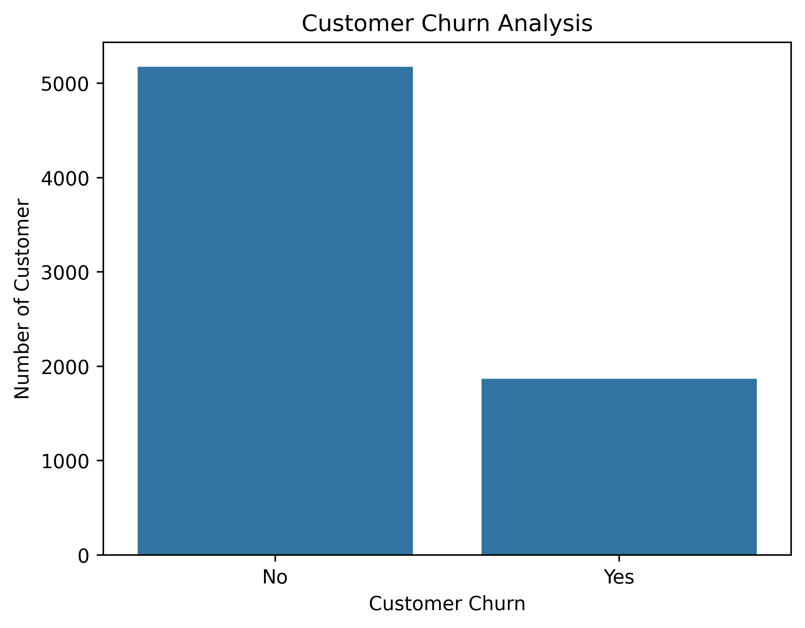
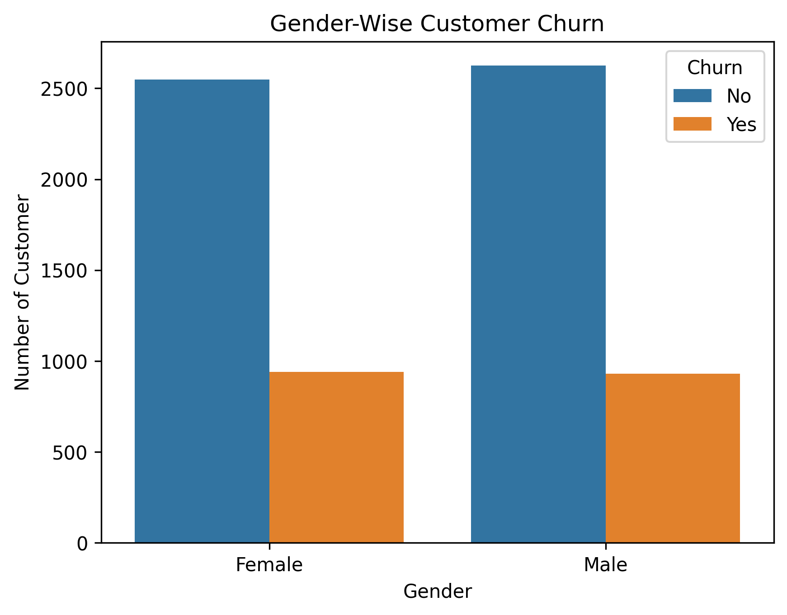
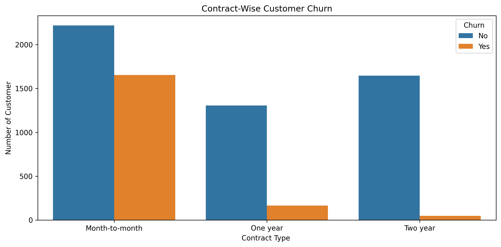
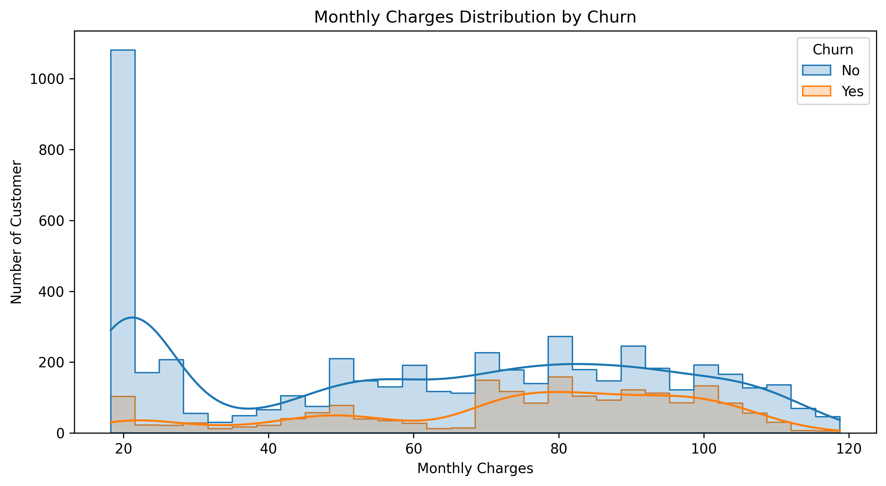

# Customer Churn Analysis Using Python

## Project Overview
This project focuses on analyzing customer churn in a telecommunications company using Python. The main objective is to understand why customers leave the company and identify patterns that can help improve customer retention.

## Dataset
- Total Customers: 7,043
- Total Columns: 21
- Dataset: Telco Customer Churn

## Tools & Technologies
- Python
- Pandas
- NumPy
- Matplotlib
- Seaborn
- Jupyter Notebook

## Data Cleaning
- Checked missing values.
- Handled missing values in TotalCharges.
- Converted TotalCharges into numeric format.
- Checked duplicate records.
- Verified data types.

## Exploratory Data Analysis
- Overall Customer Churn Analysis
- Gender-wise Churn Analysis
- Contract-wise Churn Analysis
- Payment Method Analysis
- Monthly Charges Analysis
- Customer Tenure Analysis
- Internet Service Analysis
- Senior Citizen Analysis
- Correlation Analysis

## Key Findings
- Total Customers: 7,043
- Churned Customers: 1,869
- Retained Customers: 5,174
- Overall Churn Rate: 26.54%
- Average Monthly Charges of Churned Customers: $74.44
- Average Monthly Charges of Retained Customers: $61.27
- Average Tenure of Churned Customers: 17.98 months
- Average Tenure of Retained Customers: 37.57 months

## Business Recommendations
- Offer special discounts to high-bill customers.
- Improve customer support.
- Provide attractive offers to new customers.
- Introduce loyalty rewards for long-term customers.

## Conclusion
This project helped me understand customer behavior, perform data cleaning, conduct exploratory data analysis, and create meaningful visualizations using Python.

## Data Visualizations 

### 1. Customer Churn Analysis 

### 2. Gender-Wise Churn 

### 3. Contract-Wise Churn 

### 4. Correlation Heatmap

### 5. Monthly Charges Analysis 

